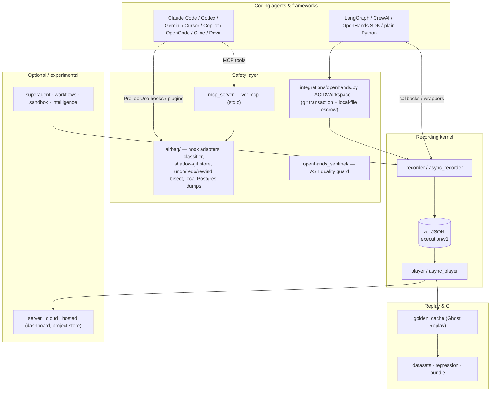

# Agent VCR architecture

> **Version:** `1.7.0` · **License:** MIT · **Recording schema:** `execution/v1` (frozen)

Agent VCR is an *intervention* layer for AI agents: it records what an agent did, and lets you
go back — files, state and history — instead of only reading logs about it.

| Git idea | Agent VCR | Module |
|---|---|---|
| commit | snapshot before every tool call · checkpoint frame | `airbag.store` · `recorder` |
| checkout / revert | `vcr undo` / `vcr rewind` · `ACIDWorkspace.rollback()` | `airbag.core` · `integrations.openhands` |
| branch | fork / resume a recorded run | `recorder.fork` · `player.resume` |
| diff | RFC-6902 patch / canonical state diff | `models.StateDiff` |
| fixture | Ghost Replay: re-run without model calls | `golden_cache` |
| CI gate | replay datasets + regression report | `datasets` · `regression` · `action.yml` |

## 1. Package map and stability



| Layer | Packages | Stability |
|---|---|---|
| Recording kernel | `models`, `recorder`, `async_recorder`, `player`, `async_player` | **Stable** — `execution/v1` is frozen; old files always load |
| Safety | `airbag/` (incl. `bisect`, `databases`), `mcp_server`, `integrations/openhands.py` (ACIDWorkspace), `openhands_sentinel/` | **Stable API**, actively developed |
| Replay & CI | `golden_cache`, `datasets`, `regression`, `bundle`, `pytest_plugin`, `action.yml` | **Stable** |
| Integrations | `integrations/langgraph.py`, `crewai.py`, `openhands_airbag.py`, `hooks/claude_code.py` | **Stable**, tested against real LangGraph 1.2, CrewAI 0.203, OpenHands SDK 1.7 |
| Dashboard & store | `server`, `cloud`, `cloud_store`, `tui` | Supported; self-hosted |
| Hosted control plane | `hosted`, `deploy/` | Foundation only — not a finished multi-tenant SaaS |
| Agent runtime | `superagent/`, `workflows/`, `sandbox/`, `intelligence/` | **Experimental** — APIs may change |

`import agent_vcr` is lazy (PEP 562): optional layers are imported only when one of their names is
used, so hooks and the CLI start fast and the core never needs optional dependencies.

## 2. The airbag

The airbag protects a project directory against whatever an agent does through its tools:

```text
agent tool call ──► hook process (python -m agent_vcr.airbag.hook <agent>)
                      │  agents.parse_payload()   normalize the agent's JSON → ToolCall
                      │  classify()               read / write / destructive / irreversible
                      │  ShadowStore.snapshot()   (skipped for read-only commands)
                      ▼
                    Decision ──► rendered in the agent's own format
                                 continue (+ notice) · ask · deny/block
```

* **Store.** One private git directory per project under the user's state directory
  (`~/.local/state/agent-vcr/airbag/<name>-<hash>/`), with its own index, `info/exclude`
  (dependency and build trees) and `info/attributes` (no eol/filter conversion). Snapshots are
  parentless commits under `refs/airbag/<seq>`; an unchanged tree reuses the previous snapshot.
  The user's `.git` is never read or written by the store.
* **What is captured.** Every file `git` would see (tracked and untracked, honoring
  `.gitignore`), small ignored *precious* files (`.env*`, SQLite) — SQLite through the
  online-backup API — and, for commands that delete it, a hardlink copy of the project's `.git`.
  Files over the size limit are removed from the index so a restore can never write a stale copy
  over them.
* **Restore.** A restore first snapshots the current state (so it is undoable), then applies the
  diff between the two trees: deletes paths that did not exist at the target, writes the others,
  restores private permission bits, skips nested repositories and anything present on disk but
  unprotected, and repairs a missing/broken/replaced `.git` (moving the damaged one aside).
* **Decisions.** The airbag never grants permission. Irreversible commands are escalated with
  the strongest mechanism the agent offers ("ask" for Claude Code, Gemini CLI ≥ 0.36, Copilot
  CLI; deny/block elsewhere) and can be approved once with `vcr airbag allow`.
* **Databases (opt-in).** Local Postgres URLs listed in `AGENT_VCR_AIRBAG_DATABASES` (or
  `.vcr/airbag-databases.json`) are dumped with `pg_dump` into the store before a destructive
  SQL command; the dump is attached to that snapshot and restored by undo/rewind. Non-local
  hosts are refused.
* **Bisect.** `airbag/bisect.py` materializes snapshots into temporary directories
  (a throwaway index and `checkout-index`), runs the test command there and binary-searches the
  timeline. It only adds one append-only "before bisect" snapshot; nothing else is written.
* **MCP.** `mcp_server.py` exposes status, timeline, check, snapshot and (confirm-gated)
  undo/rewind as MCP tools over stdio, reusing the same `Airbag` API as the CLI.
* **Concurrency.** Store creation and every snapshot/restore run under an `flock`; one tool call
  delivered through two agents' hooks within 5 s is handled once.

User-facing details: [airbag.md](airbag.md).

## 3. Recording kernel and data models

### 3.1 The `execution/v1` Frozen Schema Contract

All session recordings adhere to the frozen `execution/v1` schema (schema version `1.0.0`), formalized via Pydantic v2 with `extra="ignore"` to guarantee absolute forward and backward compatibility:

```python
class FrameType(str, Enum):
    NODE_EXECUTION = "node"
    TOOL_CALL = "tool"
    LLM_CALL = "llm"
    ERROR = "error"
    CHECKPOINT = "checkpoint"

class FrameMetadata(BaseModel):
    model: str | None = None
    latency_ms: float = 0.0
    tokens_used: int | None = None
    tokens_input: int | None = None
    tokens_output: int | None = None
    cost_usd: float | None = None
    error_type: str | None = None
    error_message: str | None = None
    custom: dict[str, Any] = Field(default_factory=dict)

class Frame(BaseModel):
    model_config = ConfigDict(extra="ignore")

    schema_version: str = "1.0.0"
    frame_id: str = Field(default_factory=lambda: str(uuid.uuid4()))
    session_id: str
    parent_frame_id: str | None = None
    timestamp: datetime = Field(default_factory=lambda: datetime.now(timezone.utc))
    frame_type: FrameType = FrameType.NODE_EXECUTION
    node_name: str
    input_state: dict[str, Any]
    output_state: dict[str, Any]
    metadata: FrameMetadata = Field(default_factory=FrameMetadata)
    state_diff: list[dict] | None = None

class Session(BaseModel):
    model_config = ConfigDict(extra="ignore")

    schema_version: str = "1.0.0"
    session_id: str = Field(default_factory=lambda: str(uuid.uuid4()))
    parent_session_id: str | None = None
    forked_from_frame: int | None = None
    created_at: datetime = Field(default_factory=lambda: datetime.now(timezone.utc))
    updated_at: datetime = Field(default_factory=lambda: datetime.now(timezone.utc))
    metadata: dict[str, Any] = Field(default_factory=dict)
    tags: list[str] = Field(default_factory=list)
    frame_count: int = 0
    total_tokens: int = 0
    total_cost_usd: float = 0.0
```

### 3.2 Dual State-Diff Strategy: RFC-6902 & Canonical Diff

Agent VCR maintains two representations of state transitions:

1. **Storage Optimization (`StateDiff.to_json_patch`):**
   In diff recording mode, frames store RFC-6902 compliant JSON patch operations (`add`, `remove`, `replace`). This keeps `.vcr` files small when large states change a little at each step.
2. **Analysis & Comparison (`StateDiff.compute`):**
   Produces structured dictionaries (`added`, `removed`, `modified`, `unchanged`), used by `VCRPlayer.compare_frames` and the regression testing engine.

### 3.3 Storage Engine: Resilient Append-Only JSONL

Files are stored as `.vcr` files (JSON Lines format). Line 1 is always the `Session` header; all subsequent lines are sequential `Frame` records.
- **Atomic fsync:** Writes are flushed to the OS buffer and synced (`os.fsync`) at critical transaction boundaries.
- **Corrupt-Line Isolation:** The reader skips malformed or truncated lines (e.g., from unbuffered hard crashes) and reports them in `player.skipped_lines`.
- **Header Synchronization:** If append operations cause the physical frame count or token count to diverge from the session header line, `VCRRecorder.save()` performs an atomic rewrite using `tempfile.mkstemp` and `os.replace`.

### 3.4 Where the other layers live

* **ACID workspace** — git-branch transactions plus local-file escrow for your own Python agent:
  [acid-workspace.md](acid-workspace.md).
* **Sentinel** — AST quality guard for agent-written code: [sentinel.md](sentinel.md).
* **Ghost Replay and Agent CI** — replay recorded outputs and gate regressions:
  [recording-and-replay.md](recording-and-replay.md), [agent-ci.md](agent-ci.md).

## 4. Experimental layers

These ship in the package and are tested, but their APIs may change between minor releases.

| Layer | Package | Guide |
|---|---|---|
| SuperAgent runtime — plans, tool gateway, policy, budgets, approvals | `superagent/` | [experimental/superagent.md](experimental/superagent.md) |
| Workflow engine — DAGs, retries, compensation, schedules | `workflows/` | [experimental/workflow.md](experimental/workflow.md) |
| Reliability intelligence — failure clusters, risk, costs, recovery | `intelligence/` | [experimental/intelligence.md](experimental/intelligence.md) |
| Sandboxes — `LocalSandbox` (convenience runner, **not** a security boundary), `E2BSandbox` (microVM) | `sandbox/` | API docstrings |

## 5. Self-hosted store

The dashboard server and project store (`agent_vcr.server`, `agent_vcr.cloud_store`, `agent_vcr.cloud`) keep recordings per project with scoped tokens. How to run it: [dashboard.md](dashboard.md); hosting: [deployment/railway.md](deployment/railway.md).

### 5.1 Tenant & Storage Isolation

On-disk storage layout under `<root>/`:
```
<root>/
├── projects.json                      # Project metadata registry
├── tokens.json                        # SHA-256 token hashes (never plaintext)
└── projects/
    └── <project_id>/
        └── sessions/
            ├── <session_id_1>.vcr     # Standard execution/v1 JSONL
            └── <session_id_2>.vcr
```

- **Namespace Confinement:** All paths are slug-checked (`^[a-zA-Z0-9_.-]+$`) and validated via `path.is_relative_to(project_dir)` to prevent path traversal attacks.
- **HMAC Scoped API Tokens:** Tokens are minted once and hashed via SHA-256. At validation time, tokens are checked in constant time via `hmac.compare_digest`. Roles (`owner` for read/write/admin, `member` for read-only) are enforced at the router level.

### 5.2 Streaming Ingestion Gate

To prevent memory exhaustion attacks:
- Session uploads are accepted as chunked streams (1MB chunks) with a hard 100MB cap.
- Uploads are staged in temporary files.
- `VCRPlayer.verify_integrity()` inspects frame order, timestamps, and syntax **before** promoting the file into the project's visible session pool. Corrupted uploads are rejected with HTTP 422.
