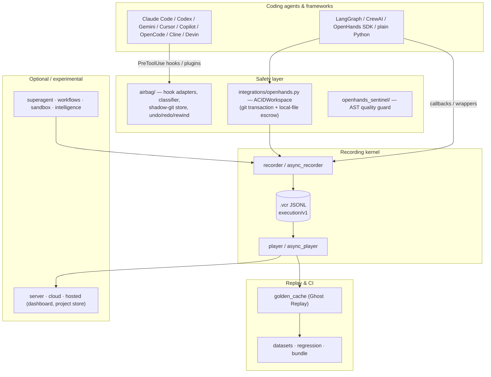

# Agent VCR architecture

> **Version:** `1.6.0` · **License:** MIT · **Recording schema:** `execution/v1` (frozen)

Agent VCR is an *intervention* layer for AI agents: it records what an agent did, and lets you
go back — files, state and history — instead of only reading logs about it.

| Git idea | Agent VCR | Module |
|---|---|---|
| commit | snapshot before every tool call · checkpoint frame | `airbag.store` · `recorder` |
| checkout / revert | `vcr undo` / `vcr rewind` · `ACIDWorkspace.rollback()` | `airbag.core` · `integrations.openhands` |
| branch | fork / resume a recorded run | `recorder.fork` · `player.resume` |
| diff | RFC-6902 patch / canonical state diff | `models.StateDiff` |
| fixture | Ghost Replay: re-run without model calls | `golden_cache` |
| CI gate | replay datasets + regression report | `datasets` · `regression` · `action.yml` |

## 1. Package map and stability



| Layer | Packages | Stability |
|---|---|---|
| Recording kernel | `models`, `recorder`, `async_recorder`, `player`, `async_player` | **Stable** — `execution/v1` is frozen; old files always load |
| Safety | `airbag/`, `integrations/openhands.py` (ACIDWorkspace), `openhands_sentinel/` | **Stable API**, actively developed |
| Replay & CI | `golden_cache`, `datasets`, `regression`, `bundle`, `action.yml` | **Stable** |
| Integrations | `integrations/langgraph.py`, `crewai.py`, `openhands_airbag.py`, `hooks/claude_code.py` | **Stable**, tested against real LangGraph 1.2, CrewAI 0.203, OpenHands SDK 1.7 |
| Dashboard & store | `server`, `cloud`, `cloud_store`, `tui` | Supported; self-hosted |
| Hosted control plane | `hosted`, `deploy/` | Foundation only — not a finished multi-tenant SaaS |
| Agent runtime | `superagent/`, `workflows/`, `sandbox/`, `intelligence/` | **Experimental** — APIs may change |

`import agent_vcr` is lazy (PEP 562): optional layers are imported only when one of their names is
used, so hooks and the CLI start fast and the core never needs optional dependencies.

## 2. The airbag

The airbag protects a project directory against whatever an agent does through its tools:

```text
agent tool call ──► hook process (python -m agent_vcr.airbag.hook <agent>)
                      │  agents.parse_payload()   normalize the agent's JSON → ToolCall
                      │  classify()               read / write / destructive / irreversible
                      │  ShadowStore.snapshot()   (skipped for read-only commands)
                      ▼
                    Decision ──► rendered in the agent's own format
                                 continue (+ notice) · ask · deny/block
```

* **Store.** One private git directory per project under the user's state directory
  (`~/.local/state/agent-vcr/airbag/<name>-<hash>/`), with its own index, `info/exclude`
  (dependency and build trees) and `info/attributes` (no eol/filter conversion). Snapshots are
  parentless commits under `refs/airbag/<seq>`; an unchanged tree reuses the previous snapshot.
  The user's `.git` is never read or written by the store.
* **What is captured.** Every file `git` would see (tracked and untracked, honoring
  `.gitignore`), small ignored *precious* files (`.env*`, SQLite) — SQLite through the
  online-backup API — and, for commands that delete it, a hardlink copy of the project's `.git`.
  Files over the size limit are removed from the index so a restore can never write a stale copy
  over them.
* **Restore.** A restore first snapshots the current state (so it is undoable), then applies the
  diff between the two trees: deletes paths that did not exist at the target, writes the others,
  restores private permission bits, skips nested repositories and anything present on disk but
  unprotected, and repairs a missing/broken/replaced `.git` (moving the damaged one aside).
* **Decisions.** The airbag never grants permission. Irreversible commands are escalated with
  the strongest mechanism the agent offers ("ask" for Claude Code, Gemini CLI ≥ 0.36, Copilot
  CLI; deny/block elsewhere) and can be approved once with `vcr airbag allow`.
* **Concurrency.** Store creation and every snapshot/restore run under an `flock`; one tool call
  delivered through two agents' hooks within 5 s is handled once.

User-facing details: [airbag.md](airbag.md).

## 3. Recording kernel and data models

### 3.1 The `execution/v1` Frozen Schema Contract

All session recordings adhere to the frozen `execution/v1` schema (schema version `1.0.0`), formalized via Pydantic v2 with `extra="ignore"` to guarantee absolute forward and backward compatibility:

```python
class FrameType(str, Enum):
    NODE_EXECUTION = "node"
    TOOL_CALL = "tool"
    LLM_CALL = "llm"
    ERROR = "error"
    CHECKPOINT = "checkpoint"

class FrameMetadata(BaseModel):
    model: str | None = None
    latency_ms: float = 0.0
    tokens_used: int | None = None
    tokens_input: int | None = None
    tokens_output: int | None = None
    cost_usd: float | None = None
    error_type: str | None = None
    error_message: str | None = None
    custom: dict[str, Any] = Field(default_factory=dict)

class Frame(BaseModel):
    model_config = ConfigDict(extra="ignore")

    schema_version: str = "1.0.0"
    frame_id: str = Field(default_factory=lambda: str(uuid.uuid4()))
    session_id: str
    parent_frame_id: str | None = None
    timestamp: datetime = Field(default_factory=lambda: datetime.now(timezone.utc))
    frame_type: FrameType = FrameType.NODE_EXECUTION
    node_name: str
    input_state: dict[str, Any]
    output_state: dict[str, Any]
    metadata: FrameMetadata = Field(default_factory=FrameMetadata)
    state_diff: list[dict] | None = None

class Session(BaseModel):
    model_config = ConfigDict(extra="ignore")

    schema_version: str = "1.0.0"
    session_id: str = Field(default_factory=lambda: str(uuid.uuid4()))
    parent_session_id: str | None = None
    forked_from_frame: int | None = None
    created_at: datetime = Field(default_factory=lambda: datetime.now(timezone.utc))
    updated_at: datetime = Field(default_factory=lambda: datetime.now(timezone.utc))
    metadata: dict[str, Any] = Field(default_factory=dict)
    tags: list[str] = Field(default_factory=list)
    frame_count: int = 0
    total_tokens: int = 0
    total_cost_usd: float = 0.0
```

### 3.2 Dual State-Diff Strategy: RFC-6902 & Canonical Diff

Agent VCR maintains two representations of state transitions:

1. **Storage Optimization (`StateDiff.to_json_patch`):**
   In diff recording mode, frames store RFC-6902 compliant JSON patch operations (`add`, `remove`, `replace`). This reduces `.vcr` file footprints by 65–90% in agents manipulating massive context windows.
2. **Analysis & Comparison (`StateDiff.compute`):**
   Produces structured dictionaries (`added`, `removed`, `modified`, `unchanged`), used by `VCRPlayer.compare_frames` and the regression testing engine.

### 3.3 Storage Engine: Resilient Append-Only JSONL

Files are stored as `.vcr` files (JSON Lines format). Line 1 is always the `Session` header; all subsequent lines are sequential `Frame` records.
- **Atomic fsync:** Writes are flushed to the OS buffer and synced (`os.fsync`) at critical transaction boundaries.
- **Corrupt-Line Isolation:** The reader skips malformed or truncated lines (e.g., from unbuffered hard crashes) and reports them in `player.skipped_lines`.
- **Header Synchronization:** If append operations cause the physical frame count or token count to diverge from the session header line, `VCRRecorder.save()` performs an atomic rewrite using `tempfile.mkstemp` and `os.replace`.

### 3.4 ACID Transactions & Git Filesystem Rollback

`ACIDWorkspace` (`agent_vcr.integrations.openhands`) combines in-memory frame recording with physical git repository transactions:

```python
with ACIDWorkspace("/path/to/repo") as ws:   # begin() on enter
    ws.savepoint({"phase": "planned"}, node_name="planner")
    # Agent executes tools that modify the filesystem...
    # Clean exit -> commit(); an exception -> abort() (files rewound, branch dropped)
```

- **Branch Isolation:** Each session runs on an isolated git branch: `acid/<session_id>`. This prevents multi-agent pipelines operating on the same repository from colliding.
- **Injection Protection:** Session IDs are strictly validated against `^[a-zA-Z0-9_\-\.]+$` to block git argument injection (such as `--orphan` flags).
- **Filesystem Rollback:** Tracked paths are restored from the savepoint commit. Eligible
  untracked and ignored regular files and symlinks are captured in a per-savepoint,
  content-addressed escrow under `.git/vcr-escrow/`; rollback removes later local paths and
  atomically restores deleted, modified, renamed, type-changed, mode-changed, or symlink-drifted
  paths. Escrow bytes never enter Git objects, commits, or VCR recordings.
- **Safety Boundary:** Local files default to a 10 MiB escrow cap. Oversized files, special files,
  `.venv`, `venv`, `node_modules`, `__pycache__`, tool caches, and `.vcr` are never removed by local
  cleanup, but their contents are not recoverable when they are outside the escrow boundary.

### 3.5 Sentinel AST Code Guardian

`openhands_sentinel` operates as a real-time static code guardian. Unlike generic linters that inspect isolated files, Sentinel performs **trajectory-aware analysis** across agent iterations:
- Function length explosion ($>50$ lines)
- Cyclomatic complexity spikes
- Class bloat and wildcard import detection
- Duplicate functions (same qualified name and same normalized body) across modules
- Per-edit growth spikes rather than growth against the first version ever seen

---

## 4. Sandboxes (experimental)

`BaseSandbox` abstracts where an agent's commands run. Only `E2BSandbox` provides isolation;
`LocalSandbox` is a convenience runner.

```
                  ┌─────────────────────────────────────────┐
                  │          BaseSandbox Interface          │
                  └────────────────────┬────────────────────┘
                                       │
                    ┌──────────────────┴──────────────────┐
                    │                                     │
                    ▼                                     ▼
     ┌──────────────────────────────┐      ┌──────────────────────────────┐
     │         LocalSandbox         │      │          E2BSandbox          │
     │  - Ephemeral Temp Workspace  │      │  - Firecracker microVM       │
     │  - Path Traversal Guard      │      │  - Sub-second Snapshot Pause │
     │  - Process-Group Termination │      │  - Isolated Network / Kernel │
     │  - FS Hash Snapshot & Diff   │      │  - Remote FS Synchronization │
     └──────────────────────────────┘      └──────────────────────────────┘
```

### 4.1 `LocalSandbox` Implementation

A scratch directory on the local machine — **not a security boundary**. Commands run as the
current user through a shell and can reach any path the user can; network, memory and CPU limits
are not enforced. What it does provide:
1. **Path checks for its file API:** `read_file` / `write_file` pass through `_resolve_safe_path()`:
   ```python
   target = (self.root_path / rel_path).resolve()
   target.relative_to(self.root_path)  # Raises PermissionError on escape
   ```
2. **Process-Group Cleanup:** Commands run under `start_new_session=True`. On timeout or termination, signals are dispatched to the process group (`os.killpg(os.getpgid(proc.pid), signal.SIGKILL)`), ensuring runaway child processes (fork bombs, background daemons) are killed cleanly.
3. **Filesystem Hashing:** Captures SHA-256 hashes of all workspace files before and after tool calls to calculate exact `FilesystemDiff` records.

### 4.2 `E2BSandbox` Implementation

Integrates with Firecracker microVMs via the E2B SDK (`e2b >= 2.46.0`):
- Each run executes in an E2B microVM with its own kernel.
- `SandboxConfig.lifetime_seconds` bounds the VM lifetime; per-command timeouts are separate.
- Non-zero exits keep stdout, stderr and the real exit code.

---

## 5. SuperAgent runtime (experimental)

The SuperAgent runtime (`agent_vcr.superagent`) executes structured plans on top of the VCR kernel. It guarantees that **every transition** is recorded and constrained by strict safety bounds.

```
Goal ──► LLMPlanner ──► PlanIR ──► PlanBuilder.validate()
                                           │
 ┌─────────────────────────────────────────┴─────────────────────────────────────────┐
 │ STEP EXECUTION PIPELINE                                                           │
 │                                                                                   │
 │  1. Policy Check       ──► Forbid list? Irreversible action? (Allow / Deny / Gate) │
 │  2. Budget Check       ──► Token / Cost USD / Latency cap breached?               │
 │  3. Human Approval     ──► Fail-closed Approver protocol (Auto / Callback)         │
 │  4. ToolGateway        ──► Parameter validation, strict per-call timeout           │
 │  5. Verifier           ──► Declarative output contract assertion                  │
 │  6. VCR Checkpoint     ──► State persisted to JSONL + memory update               │
 └───────────────────────────────────────────────────────────────────────────────────┘
```

### 5.1 Plan Specification & Validation

Plans are explicit DAGs of nodes (`PlanStep`), never unconstrained natural language:
- Dependency tracking via `depends_on`.
- Upstream data wiring via `$step_id.key` JSON pointers.
- Cycle detection, unknown reference rejection, and bound checks performed by `PlanBuilder`.
- `LLMPlanner` utilizes LiteLLM (`litellm >= 1.100.0`) with validation feedback loops: if the model outputs an invalid plan, validation errors are fed back into the prompt for iterative correction.

### 5.2 Policy & Budget Enforcement

- **Static Policy (`Policy`):** Evaluated prior to every step. Rejects forbidden tools/agents and automatically flags irreversible operations (e.g., `send_email`, `execute_refund`) as requiring human approval.
- **Dynamic Ledger (`BudgetTracker`):** Maintains running totals of tokens, dollar spend, and elapsed execution milliseconds. If `current_spend + step_max_cost > max_total_cost_usd`, execution is aborted before the step executes.

### 5.3 Working Memory & Secret Redaction

`MemoryStore` provides step-namespaced scratchpad memory with **deep automated secret redaction**:
- Scans values recursively against regex patterns matching:
  - OpenAI, Anthropic, GitHub, Slack API keys (`sk-...`, `ghp_...`, `xoxb-...`)
  - Bearer tokens, private RSA/EC keys, password parameters
- Persisted snapshots and VCR frame traces **never write raw credentials to disk**.

### 5.4 Long-Term Semantic Memory (`VectorMemoryStore`)

Cross-session retrieval is provided by `VectorMemoryStore`, integrating with Qdrant (`qdrant-client >= 1.19.0`):
- Automatic fallback to an in-memory cosine similarity engine when Qdrant is unavailable.
- Built-in zero-dependency dense embedder (`default_embedder`) based on deterministic character/token n-gram hashing.
- Auto-sanitization ensures vector payloads never store unredacted secrets.

---

## 6. Reliability intelligence (experimental)

The intelligence tier (`agent_vcr.intelligence`) operates over accumulated VCR sessions, turning raw execution traces into actionable fleet reliability data without requiring external LLMs.

### 6.1 Failure Normalization & Clustering

Raw error messages are filled with volatile tokens (UUIDs, memory addresses, timestamps, file paths, numbers). `normalize_message()` masks these tokens into canonical templates:

```
"Connection timeout to 192.168.1.42:8080 after 3000ms"
                      ▼
"Connection timeout to <path> after <n>"
```

Errors are clustered into a 16-character SHA-256 fingerprint:
$$\text{ClusterKey} = \text{SHA256}(\text{error\_type} \parallel \text{node\_name} \parallel \text{normalized\_template})[0:16]$$

This allows thousands of fleet failures to be aggregated into actionable issue buckets.

### 6.2 Deterministic 0–100 Risk Scoring Engine

`score_session()` calculates a deterministic risk rating based on observable metrics:

$$\text{RiskScore} = w_{\text{err}} S_{\text{err}} + w_{\text{den}} S_{\text{den}} + w_{\text{drift}} S_{\text{drift}} + w_{\text{cost}} S_{\text{cost}} + w_{\text{lat}} S_{\text{lat}}$$

| Factor | Weight | Evaluation Logic |
|---|---|---|
| **Errors** | 30% (scale to 70% on total failure) | Ratio of `FrameType.ERROR` frames. $\ge 75\%$ error rate triggers immediate HIGH risk. |
| **Denials** | 20% | Count of policy denials, approval rejections, and budget blocks. |
| **Drift** | 20% | Introduction of novel tools or models absent in baseline session. |
| **Cost** | 15% | Percentage spike in cost above baseline median (savings are not penalized). |
| **Latency** | 15% | Percentage spike in execution latency above baseline median. |

**Classification:**
- Score $< 30$: `LOW`
- $30 \le \text{Score} < 65$: `MEDIUM`
- $\ge 65$: `HIGH`

### 6.3 Autonomous Recovery Planner

Classifies failure types and produces a ranked list of recovery actions sorted by blast radius:

1. **Transient Faults (Timeouts, Rate Limits 429/503):**
   $\rightarrow$ `action="retry", auto=True` (Safe to execute automatically).
2. **Interrupted Workflows:**
   $\rightarrow$ `action="resume", auto=True` (Safe; RunStore preserves state).
3. **Verified Checkpoints Exist:**
   $\rightarrow$ `action="fork", auto=False` (Requires human or policy approval).
4. **Tool Misuse / Schema Violations:**
   $\rightarrow$ `action="rollback", auto=False` (Reverts git workspace to clean state).
5. **Policy / Approval Denials:**
   $\rightarrow$ `action="escalate", auto=False` (Directs to human reviewer).

### 6.4 Empirical Model Router

`ModelRegistry` attributes cost, token spend, latency, and success rates per model across historical `.vcr` traces. `route()` picks the optimal model using deterministic constraints:

1. Explicit model preference matching.
2. Cheapest model satisfying $\text{success\_rate} \ge \text{min\_success}$ (default 80%).
3. Fallback chains for automatic failover.

---

## 7. Self-hosted store and hosted control plane

The cloud subsystem (`agent_vcr.server`, `agent_vcr.cloud_store`, `agent_vcr.cloud`) provides an enterprise-ready control plane:

### 7.1 Tenant & Storage Isolation

On-disk storage layout under `<root>/`:
```
<root>/
├── projects.json                      # Project metadata registry
├── tokens.json                        # SHA-256 token hashes (never plaintext)
└── projects/
    └── <project_id>/
        └── sessions/
            ├── <session_id_1>.vcr     # Standard execution/v1 JSONL
            └── <session_id_2>.vcr
```

- **Namespace Confinement:** All paths are slug-checked (`^[a-zA-Z0-9_.-]+$`) and validated via `path.is_relative_to(project_dir)` to prevent path traversal attacks.
- **HMAC Scoped API Tokens:** Tokens are minted once and hashed via SHA-256. At validation time, tokens are checked in constant time via `hmac.compare_digest`. Roles (`owner` for read/write/admin, `member` for read-only) are enforced at the router level.

### 7.2 Streaming Ingestion Gate

To prevent memory exhaustion attacks:
- Session uploads are accepted as chunked streams (1MB chunks) with a hard 100MB cap.
- Uploads are staged in temporary files.
- `VCRPlayer.verify_integrity()` inspects frame order, timestamps, and syntax **before** promoting the file into the project's visible session pool. Corrupted uploads are rejected with HTTP 422.

---

## 8. Agent CI & Verification Gate

The testing architecture integrates with CI pipelines to block regressions before merging pull requests:

```
                  Git PR Trigger (Code / Prompt / Tool Change)
                                       │
                                       ▼
                     Agent CI Execution (action.yml)
                                       │
                ┌──────────────────────┴──────────────────────┐
                │                                             │
                ▼                                             ▼
       Golden Baseline Runs                          Candidate Execution
      (.vcr/datasets/<name>/)                        (New agent version)
                │                                             │
                └──────────────────────┬──────────────────────┘
                                       │
                                       ▼
                          Regression Engine Evaluation
               Evaluates 9 Dimensions: Output Correctness,
               Tool Drift, State Transitions, Token Usage,
               Cost Delta, Latency Delta, Error Rate,
               Policy Violations, Checkpoint Integrity.
                                       │
                     ┌─────────────────┴─────────────────┐
                     │                                   │
              [PASS / LOW RISK]                  [FAIL / HIGH RISK]
                     │                                   │
                     ▼                                   ▼
             Merge Approved                       PR Blocked +
                                            Detailed Markdown Report
```

This ensures that optimizations to prompts, models, or tool schemas never introduce silent regressions into production environments.
